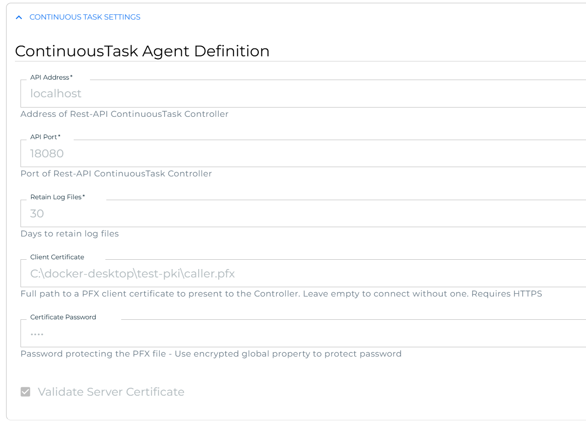
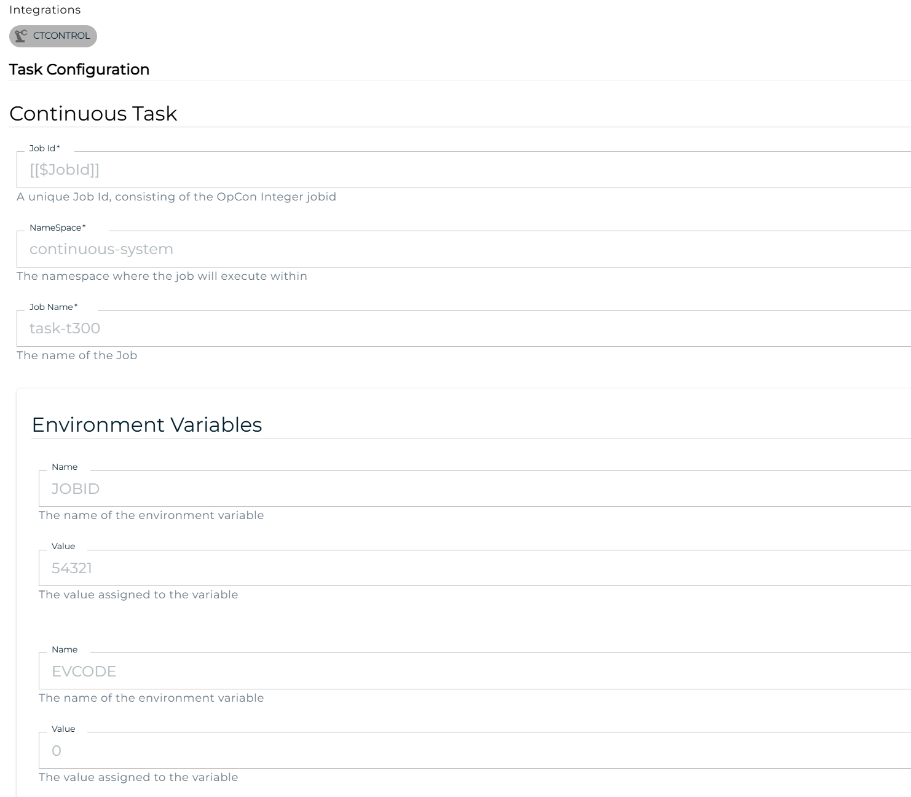

# OpCon Continuous Task

The OpCon Continuous Task integrates an OpCon system with the Continuous Task Controller (custom Kubernetes Job Controller) supporting the execution of Kubernetes Jobs (Continuous Custom Resources) within a Kubernetes Cluster environment.
The integration submits tasks for execution, monitors the tasks until completion, retrieves the job logs from the associated pods and performs a clean-up of the Kubernetes job after the task completes successfully.
If the task fails, the logs are not retrieved and the Kubernetes job is not cleaned up by the integration; the job remains until its ttlSecondsAfterFinished expires.

The OpCon task status follows the Kubernetes job status:

| Kubernetes job | OpCon task |
|---|---|
| Pending, Running, Suspended | Running |
| Succeeded | Complete (logs retrieved and job cleaned up) |
| Failed, Unknown | Failed |
| Controller unreachable | Running (Offline) for up to 60 seconds while waiting for Kubernetes to restart the Controller, then Failed |

Cancelling the task suspends the job, retrieves the logs and then cleans up (deletes) the job.

The Continuous Tasks are automatically configured by the Continuous Task Controller once the configuration is completed.

This means that, when the Continuous Task Controller is deployed with **HOSTSYSTEM** set to OPCON, once a new Continuous Custom Resource is deployed within the Kubernetes Cluster, the OpCon Continuous Task will be configured. If the Continuous Custom Resource is modified, the OpCon Continuous task will be updated
and if the Continuous Custom Resource is removed from the Kubernetes Cluster, the OpCon Continuous Task will be Build Disabled.

The automated task configuration requires the definition of an agent before tasks can be defined.

The OpCon Continuous Task software is an OpCon ACS Connector that can be downloaded from the SMA FTP Site.

## Installation

To install the Continuous Task, complete the following steps:

1. Download the `ACSContinuousTask.zip` file from the SMA FTP Site. The file is located at one of the following paths:
   - `/OpCon Releases/Integrations/ACSContinuousTask/`
2. Select the required version.
3. Unzip the `ACSContinuousTask.zip` file.
4. Complete the steps for your deployment type:

   | Deployment type | Steps |
   |---|---|
   | On-prem | Copy the `ACSContinuousTask` directory to the `\\SAM\\plugins` directory. Restart the **SMA OpCon Services Manager** and **SMA OpCon RestAPI** service. |
   | Cloud | Copy the `ACSContinuousTask` directory to the `\\Relay\\plugins` directory. Restart the **SMA OpCon Relay** service. |

The connector is installed and available for configuration in Solution Manager.

## Upgrade

To upgrade the OpCon Continuous Task, complete the following steps:

1. Download the `ACSContinuousTask.zip` file from the SMA FTP Site. The file is located at one of the following paths:
   - `/OpCon Releases/Integrations/ACSContinuousTask/`
2. Unzip the `ACSContinuousTask.zip` file.
3. Complete the steps for your deployment type:

   | Deployment type | Steps |
   |---|---|
   | On-prem | Stop the **SMA OpCon Services Manager** and **SMA OpCon RestAPI** service. Copy the `ACSContinuousTask` directory to the `\\SAM\\plugins` directory. Restart the **SMA OpCon Services Manager** and **SMA OpCon RestAPI** service. |
   | Cloud | Copy the `ACSContinuousTask` directory to the `\\Relay\\plugins` directory. Restart the **SMA OpCon Relay** service. |

The connector is upgraded to the new version.

## Continuous Task Agent Configuration

Once the installation is complete, ensure that you have the certificate information required to establish a connection to the Continuous Task Controller deployed within the Kubernetes Cluster.
It should be noted that there can only be one Continuous Task Agent associated with the Continuous Task Controller if a target host is defined in the deployment information (**HOSTSYSTEM** OPCON; the values NONE and CONTINUUM do not create tasks in OpCon).

It is possible for multiple Continuous Task Agents to submit task requests to the Continuous Task Controller.

The definition is created by adding a new ACS Continuous Task agent in Solution Manager. Required fields are shown in red.

To define the ACS Continuous Task connection, complete the following steps:

1. Open Solution Manager.
2. From the Home page, select **Library**.
3. From the **Administration** menu, select **Agents**.
4. Select **+Add**.
5. Enter the agent details:
   - Enter a unique name for the connection.
   - Select **Continuous Task** from the **Type** list.
   - Select **General Settings**.
   - In the **NetCom** field, enter `<Default>` or a Netcom or Relay name.
   - Select **Continuous Task Settings**.
   - In the **API Address** field (required), enter the address of the Continuous Task Controller Executor Rest-API (host name or IP address, without a scheme). The agent always connects using HTTPS, so the Controller must be deployed with TLSMODE=REQUIRE.
   - In the **API Port** field (required), enter the configured port number associated with the Continuous Task Controller Executor Rest-API.
   - In the **Retain Log Files** field, enter the number of days to retain the job log files (default 30). Job logs are written to the jobOutput/ContinuousTask folder of the plugin, one KubeJob-*.log file per run.
   - In the **Client Certificate** field, enter the full path to the client .pfx file (i.e. c:\test\pki\caller.pfx).
   - In the **Certificate Password** field, enter the password associated with the certificate defined in the **Client Certificate** field.
   - To validate the server certificate, select the **Validate Server Certificate** checkbox. Reject the Controller certificate if it is untrusted, 
     expired or does not match the API Address. Leave disabled for a self-signed Controller certificate.
6. Select **Save**.
7. Select **Communications Settings**, set **Requires XML Escape Sequences:User-Defined** to **True**, then select **Save**.
8. Select the **Change Communication Status** button and select **Enable Full Comm**

Once **Enable Full Comm** has been selected, the agent will submit a **heartbeat** request to establish if the Continuous Task Controller is available. The heartbeat does not present the client certificate and does not validate the server certificate.

## Continuous Task Configuration

While the continuous tasks are automatically inserted into the assigned workflow (workflowName attribute in the custom resource yaml file) if a target host is 
defined (**HOSTSYSTEM** OPCON), it is possible to define Continuous tasks manually. With any other HOSTSYSTEM value the tasks are not created automatically and must be defined manually.

It should be noted that the actual task definition information namespace, image, command, arguments, environment variables are all defined in the custom resource that is deployed to 
the Continuous Custom Resource Definition using the appropriate deployment tools. The OpCon Continuous task is simply a pointer to the definition in the Continuous Custom Resource Definition.
The OpCon Continuous Task provides namespace, task name and environment variables where the namespace and task name are used to retrieve the custom resource information and the environment
variables overwrite the values defined in the custom resource. 

The definition is created by adding a new ACS Continuous Task in Solution Manager. Required fields are shown in red.

### Defining tasks

The ACS Continuous Task connection supports the following job types:

| Job type | Description |
|---|---|
| ContinuousTask | Submit a task request to the Continuous Task Controller |

To open the master job definition form, complete the following steps:

1. Open Solution Manager.
2. From the Home page, select **Library**.
3. From the **Administration** menu, select **Master Jobs**.
4. Select **+Add**.
5. In the **Schedule** list, select the schedule.
6. In the **Name** field, enter a unique name for the job (it is recommended that the job name has the following format **namespace(.)name** where namespace 
   and task name match the values in the custom resource metadata section).
7. In the **Job Type** list, select **Continuous Task**.
8. In the **Task Type** list, the task type will be **ContinuousTask** as this is the only task type currently available.
9. Select the **Task Details** button.

1. In the **Integration Selection** section, select the Continuous Task Controller connection.
2. In the **Continuous Task** section enter the information.
   - In the **Job Id** field, enter a unique jobid that can be passed along with the job submission (it is passed as the JOBID environment variable). This field is required and defaults to the OpCon JobId property ([[$JobId]]). If
     the task fails, the failed jobid will be submitted when the task is restarted instead of the new OpCon jobid.
   - In the **NameSpace** field (required), enter the namespace value defined in the custom resource metadata section.
   - In the **Job Name** field (required), enter the name value defined in the custom resource metadata section.
   - **Environment Variables**: add values to be passed with the submission request. 
    - To add a environment variable to the list, select the **+ AddItem** button and enter the name and value.
    - To update the value of an environment variable, update the value associated with the required environment variable in the **Environment Variables** list.
    - To remove an environment variable from the list, select the **-** button to the right of the field.
    - If required select the **Debug** checkbox to ensure that additional debug information will be included in the job log.
3. Select **Save**.
4. Add a frequency to the job
