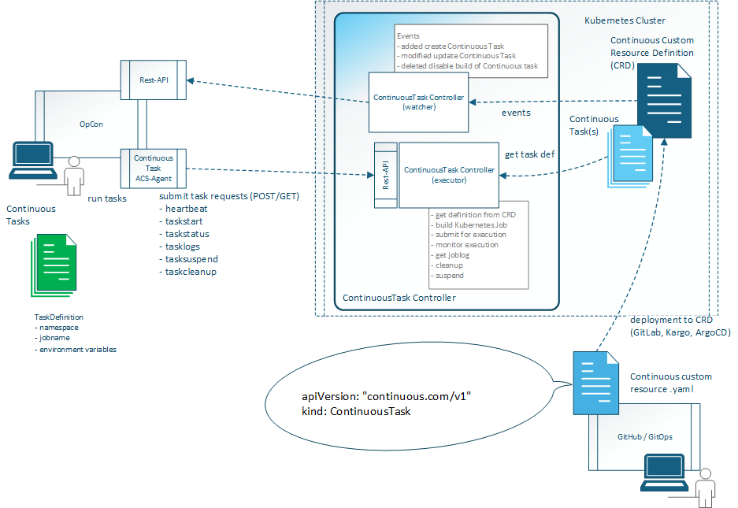

# Continuous Task Controller

A Kubernetes Job is a piece of data, and the Kubernetes Job controller is the code that acts on it.

A Job is an object stored in the API server. It does nothing by itself. It records two things:
- spec: what you want, e.g. "run this Pod template until 3 Pods succeed, retry at most 6 times."
- status: what has happened so far: the counts of active, succeeded and failed Pods, plus conditions such as Complete, Failed and Suspended.

The Job controller is a control loop built into Kubernetes. It runs inside kube-controller-manager on the control plane. 
It watches every Job and the Pods it owns, and keeps repeating three steps:
- It compares the Job's spec with what actually exists: how many Pods are running, have succeeded or have failed.
- It acts to close the gap. It creates Pods from spec.template, up to parallelism. When spec.suspend is true, it terminates the running Pods. It deletes extra Pods if there are too many.
- It writes the result back to the Job's status and adds the Complete or Failed condition when the Job finishes.

The ContinuousTaskController sits one layer above the Job controller and doesn't replace it:
- The ContinuousTaskController takes a ContinuousTask object plus a task submission and turns them into a Job. It then reads that Job's status back to report progress.
- The Job controller takes over from there. It creates the Pods, handles retries and suspension, and keeps updating the status that the ContinuousTaskController reads.

The ContinuousTaskController never creates Pods directly. It manages Jobs, and the Job controller manages Pods. For example, to cancel a task, 
the ContinuousTaskController sets spec.suspend: true on the Job, which makes the Job controller terminate its Pods, and then deletes the Job. 
A task that has already finished can't be cancelled.

A Continuous Task Controller can only send configuration requests to a single host system which is configured using variables during deployment (Watcher module).
A Continuous Task Controller can accept taskstart requests from multiple host systems (Executor module).

The general message flow associated with the Continuous Task Controller is as follows:

1. Create a task definition yaml file using the **continuous.com/v1** template.
   The task definition includes the name of the workflow in the host target system to which the task should be attached.
2. Deploy the yaml file to the Kubernetes cluster.
3. The task will be stored in the Continuous Custom Resource Definition associated with the cluster.
4. A Kubernetes **Added** event will be sent to the Continuous Task Controller Watcher module by the Kubernetes environment.
5. If the HOSTSYSTEM variable is OPCON, then the task will be created in the OPCON system using the defined connection variables (HOSTADDRESS, HOSTTOKEN, HOSTAGENT).
   The created jobname consists of the name space and task name fields (**namespace.taskname**) to allow the same taskname to be inserted into multiple name spaces.
   The task fields consist of the namespace, taskname and environment variables.  
   A resource without a workflowName, or whose environment variables reference OpCon properties not allowed by HOSTPROPERTYPREFIXES, is skipped (see **Continuous Resource**).
   Once the task has been added into the required workflow, the task can be scheduled.
6. Using the Continuous Task Agent, a taskstart request consisting of the namespace, taskname and environment variables is submitted to the Kubernetes Continuous Controller Executor module.
   - The actual custom resource is retrieved from the Continuous Custom Resource Definition.
   - A Kubernetes Job is created and passed to the Kubernetes environment for execution.
   - The environment variables included in the request, override the environment variables in the retrieved custom resource. 
   - A unique GUID is generated and returned to the Continuous Task Agent.
7. The Continuous Task Agent submits a taskstatus request using the GUID.
   - When the task completes
     - The Continuous Task Agent submits a tasklogs request using the GUID.
     - The Continuous Task Agent submits a taskcleanup request using the GUID.

## Components

### Continuous Resource Definition
The CustomResourceDefinition (CRD) adds the ContinuousTask type to the Kubernetes API. Once the CRD is applied, the API server accepts, stores, validates and serves ContinuousTask objects 
just as it does built-in types like Job. kubectl get, RBAC, watches and labels all work on ContinuousTask objects. 
A CRD has no behaviour of its own: the ContinuousTaskController is what turns ContinuousTask objects into Jobs.

### ContinuousTask Custom Resource
A ContinuousTask custom resource is one object of the ContinuousTask type that the CRD adds. Where the CRD is the type, a ContinuousTask resource is a single record of that type 
stored in a namespace. Each one describes a containerised task, and the controller handles it in two ways:
- It registers the task in the scheduler (None, OpCon or Continuum).
- It provides the template that a Kubernetes Job is built from each time the task runs.

A ContinuousTask Custom Resource is a long-lived definition of a task. Each run creates a new, short-lived Job from it. Editing the ContinuousTask Custom Resource changes future runs and 
updates the OpCon job definition (Continuum is not yet implemented). Jobs that already exist are unaffected.

### ContinuousTask Controller
The ContinuousTask Controller is a custom Kubernetes Job Controller. It is a single ASP.NET Core (.NET 9) service running in the cluster. 
It connects Kubernetes to an external scheduler (OpCon / Continuum). 
It does two separate jobs in the same process:
- Watcher: it keeps the scheduler's job definitions in step with the ContinuousTask resources in the cluster.
- Executor: it lets the scheduler run those tasks as Kubernetes Jobs and track them.

It's only a partial controller in the Kubernetes sense. It watches ContinuousTask resources but never writes their status, and it leaves Pods entirely to the built-in Job controller.

#### Watcher
This is responsible for syncing ContinuousTasks to the target scheduler. It is a background service that runs a cluster-wide watch on continuoustasks.continuous.com. It passes every Added, 
Modified or Deleted event to the dispatcher (OpCon / Continuum). The HOSTSYSTEM variable defines the target host system (NONE, OPCON, CONTINUUM).

| HOSTSYSTEM | Dispatcher | Description |
|---|---|---|
| **NONE**      | NoneDispatcher      | Only logs the event |
| **OPCON**     | OpConDispatcher     | Add/modify: creates or updates an OpCon ACS "Continuous Task" job named ***namespace.name*** in the schedule named by spec.workflowName, on agent HOSTAGENT. Delete: disables the OpCon job instead of deleting it |
| **CONTINUUM** | ContinuumDispatcher | Not implemented in initial release |

#### Executor
Receives requests from the scheduler through the Executor API and runs Jobs.

| Endpoint | Type | Description |
|---|---|---|
| **heartbeat** | GET | Health check for the probes (`/continuoustc/api/heartbeat`). Returns status, host system, whether the watcher is connected, the number of task cache entries (empty after a restart) and a timestamp. Never requires a client certificate |
| **taskstart** | POST | Body: {name, namespace, envars}. Reads the ContinuousTask, builds a Job from its template with the request's env vars merged in, creates it, and returns a new GUID as the task id. Returns 404 CRD_NOT_FOUND if the resource doesn't exist |
| **taskstatus/{id}** | GET | Returns Pending, Running, Succeeded, Failed, Suspended or Unknown, worked out from the Job |
| **tasklogs/{id}** | GET | Combines the logs of all the Job's Pods |
| **tasksuspend/{id}** | POST | Cancels the task: sets spec.suspend, then deletes the Job. Returns 409 if the task has already finished, and the id stops working afterwards |
| **taskcleanup/{id}** | POST | Deletes the Job, with a UID precondition and Background propagation so its Pods are removed too. Idempotent |

Errors are returned as `{ "error", "code" }`: 400 `BAD_REQUEST` for an invalid body or id, 404 `ID_NOT_FOUND` for an unknown id, and, for taskstatus, tasklogs, tasksuspend and taskcleanup, 502 `UPSTREAM_ERROR` when the Kubernetes API call fails. taskstart returns 400 for an invalid body and 404 `CRD_NOT_FOUND`; any other failure (for example a Kubernetes API error or a malformed resource) is not mapped and results in a 500.

Authentication. The Executor is selected by the TLSMODE variable. `DISABLED` (the default) serves plain HTTP with no authentication. `REQUIRE` serves HTTPS and requires a trusted client certificate on every endpoint except heartbeat (configured with TLSCERTPATH, TLSKEYPATH and TLSCLIENTCAPATH, and optionally TLSCLIENTSUBJECTS to limit which client identities are accepted).

How a GUID is mapped back to its Job. Each Job is labelled continuous.com/task-id=***guid*** and app.kubernetes.io/managed-by=continuoustask-controller. That makes the cluster itself the lasting record. InMemoryTaskCache is only there to save API calls. If it misses, for example after a restart, TaskJobResolver and KubernetesTaskJobLocator find the Job by its labels. Restarting the controller loses no tasks.

### Continuous Task ACS-Agent
The Continuous Task ACS-Agent provides the link between an OpCon system and the Executor of the Continuous Controller.

It provides an agent that defines the connection to the Executor and submits a **heartbeat** request to determine if the Continuous Task Controller is available. Once the connection is available it is
possible to submit **taskstart** requests. 

